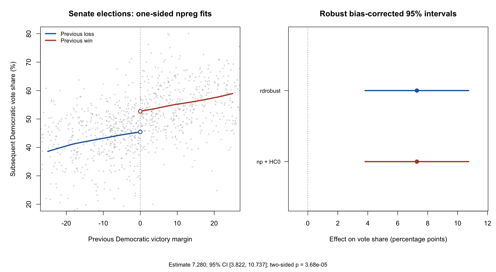
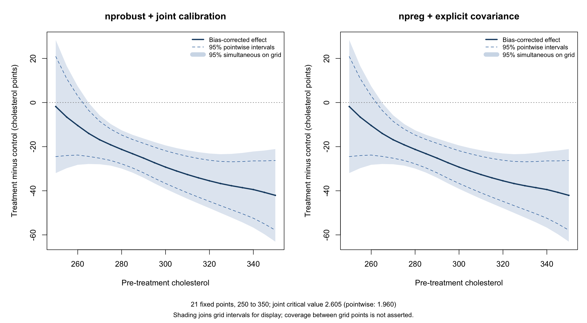

These examples use `npreg()` to fit local polynomials inside two causal
estimators. Each standalone script first computes a reference result with the
authors' package, then reproduces the estimate and inference using `npreg`
plus explicit bias-correction and covariance calculations. The causal
interpretation comes from the study design and its identifying assumptions.

Download a script and run it with `source()` in R or RStudio. It reads the pinned
public data into memory, prints the numerical results, and displays the figure
in your graphics window. Results remain available as `rd_results` or
`cholesterol_results`; the scripts create no folders or output files.
They require `np` 0.80-1 or later and either
`rdrobust` or `nprobust`; they do not install packages. The results below were
checked with `np` 0.80-1, `rdrobust` 4.1.1, and `nprobust` 1.0.0.

## Sharp regression discontinuity

The Senate-election example estimates the discontinuity in subsequent
Democratic vote share at a previous victory margin of zero. Separate fits
on either side prevent smoothing across the treatment-assignment threshold.
Under the RD continuity assumptions, their difference estimates a local
effect of winning a close election. The data and illustration come from
[Calonico, Cattaneo and Titiunik (2015)](https://journal.r-project.org/articles/RJ-2015-004/).

[Download the complete RD script](www/np_npRmpi/causal_inference/sharp_rd_inference.R).

The script uses local linear fits, a quadratic bias-correction pilot,
Epanechnikov kernels, the authors' MSE-RD bandwidth selector, and HC0 variance
estimation. Both packages use these same choices. `np`'s Epanechnikov bandwidth
is the authors' bandwidth divided by $\sqrt{5}$ because the kernel support
conventions differ.

{#fig-causal-rd fig-alt="Two panels show the Senate-election discontinuity and identical robust bias-corrected confidence intervals from rdrobust and the npreg-based implementation."}

The conventional estimate is **7.240 percentage points**; the bias-corrected
estimate is **7.280**, with a robust 95% interval of **[3.822, 10.737]**.
The robust two-sided test of a zero discontinuity has $p\approx3.68\times10^{-5}$.
The estimates, standard errors, interval endpoints and p-value agree to
numerical precision; the script checks this directly and prints the comparison.
It is also available as `rd_results$comparison` and as a
[downloadable table](www/np_npRmpi/causal_inference/rd_inference_comparison.csv).

The inference follows
[Calonico, Cattaneo and Titiunik (2014)](https://mdcattaneo.github.io/papers/Calonico-Cattaneo-Titiunik_2014_ECMA.pdf).
Epanechnikov and HC0 are supported options rather than `rdrobust`'s triangular
kernel and nearest-neighbor variance defaults. The specialized bandwidths
still come from `rdrobust`; ordinary regression cross-validation targets a
different loss.

::: {.callout-note collapse="true"}
## Complete RD code

```{r causal-rd-source}
#| echo: false
#| results: asis
cat("```r\n", paste(readLines("www/np_npRmpi/causal_inference/sharp_rd_inference.R"), collapse = "\n"), "\n```\n", sep = "")
```
:::

## Randomized treatment effects with simultaneous bands

The cholesterol example uses the Efron–Feldman randomized-trial data supplied
with `nprobust`. It compares expected post-treatment cholesterol between
assignment groups, conditional on **pre-treatment cholesterol**. There are
172 control and 165 treatment observations. The post-treatment compliance
variable is not used. The regression illustration follows
[Calonico, Cattaneo and Farrell (2019)](https://doi.org/10.18637/jss.v091.i08).

[Download the complete cholesterol script](www/np_npRmpi/causal_inference/cholesterol_simultaneous.R).

Each arm uses local linear regression with the authors' IMSE-DPI bandwidths,
a quadratic bias correction, Epanechnikov kernels and HC0 covariance. The
effect is the difference between the two bias-corrected means; the covariance
matrices add across the independent arms. `npreg` supplies the regression and
second-derivative pilot fits, and the script reproduces the authors' full
covariance across evaluation points.

{#fig-causal-cholesterol fig-alt="Two matching panels compare nprobust-based and npreg-based bias-corrected cholesterol treatment effects. Blue shading is the 95 percent simultaneous grid band and dashed lines show narrower pointwise intervals."}

The simultaneous band is an **additional inference step**, applied identically
to both implementations. It uses 50,000 joint Gaussian draws, seed 20261011,
and the maximum absolute standardized deviation across the fixed grid
$250,255,\ldots,350$. The resulting critical value is **2.605**, versus
**1.960** for pointwise intervals. This calibration preserves dependence
between the estimates; the general Gaussian-maximum approach is discussed by
[Chernozhukov, Chetverikov and Kato (2013)](https://arxiv.org/abs/1212.6906).

The same calibration tests whether the effect is zero at **every** grid point.
Here the maximum statistic is **7.779**, exceeding every simulated maximum.
The reported Monte Carlo p-value is at its resolution limit, about
$2\times10^{-5}$; it is not an exact tail probability. This rejects the
all-zero curve, while the band still includes zero at baseline values
250, 255 and 260. It does not establish an effect everywhere or test whether
the effect is constant.

Coverage is approximate and simultaneous over these **21 points**, not every
point of a continuous interval. The shaded polygon joins intervals for
display. The calculation holds the selected bandwidths fixed and relies on
the usual asymptotic conditions, including sufficiently small remaining bias
after correction. These are confidence bands for the conditional mean
contrast, not prediction bands for individual outcomes.

The script checks the bias-corrected estimates, standard errors, covariance,
band endpoints and joint test against the author-package calculation. Inspect
`cholesterol_results$np_band` and `cholesterol_results$joint_test` in R, or download
the [np band values](www/np_npRmpi/causal_inference/cholesterol_np_bands.csv),
[author-package band values](www/np_npRmpi/causal_inference/cholesterol_author_bands.csv),
[numerical checks](www/np_npRmpi/causal_inference/cholesterol_inference_comparison.csv),
or [joint-test results](www/np_npRmpi/causal_inference/cholesterol_joint_test.csv).

::: {.callout-note collapse="true"}
## Complete cholesterol code

```{r causal-cholesterol-source}
#| echo: false
#| results: asis
cat("```r\n", paste(readLines("www/np_npRmpi/causal_inference/cholesterol_simultaneous.R"), collapse = "\n"), "\n```\n", sep = "")
```
:::

## Observational treatment effects with cross-fitting

For a workflow with many adjustment covariates, see
[Doubly Robust Treatment Effects](doubly_robust_cate.qmd). That companion
example follows Fan, Hsu, Lieli and Zhang: estimate nuisance functions outside
each held-out fold, construct doubly robust scores, and use `npreg` for the
final local-linear CATE curves. A seeded simulation with known truth shows
pointwise intervals and simultaneous multiplier bands. The page explains
the identifying assumptions and the explicit exponential-weight choice,
and supplies a standalone script and reference-verification notes.

## Difference-in-differences with changing composition

For repeated cross-sectional data, see
[Difference-in-Differences with Changing Composition](difference_in_differences.qmd).
That example revisits Sant’Anna and Xu’s tariff-evasion application, freshly
estimating generalized propensities with `npconmode` and outcome regressions
with `npreg`. A standalone script produces the published/np ATT comparison
table and clustered standard errors. The page explains the adaptations and
their broad agreement with the published results.

## What is supplied by np?

In the RD and trial examples above, `npreg` supplies the local-polynomial
point and pilot fits. The scripts add
the cited bias correction and HC0 covariance formulas explicitly: ordinary
`se()` and plotting bands use different uncertainty conventions and are not
substitutes for these calculations. The authors' packages supply the
specialized bandwidths and serve as numerical references. The simultaneous
contrast band is an extension of their pointwise example, not a band claimed
to appear in the original article.

For other fitting and plotting examples, see [Worked Examples](regression.qmd)
and [Plotting and Intervals](plotting_and_intervals.qmd).
