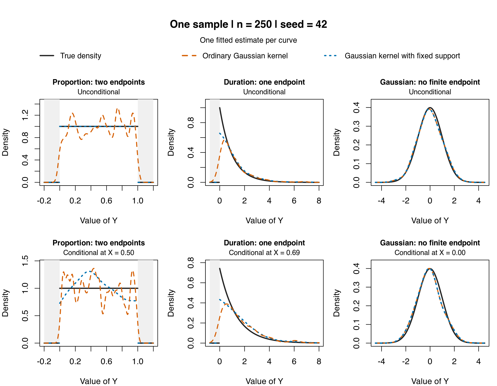
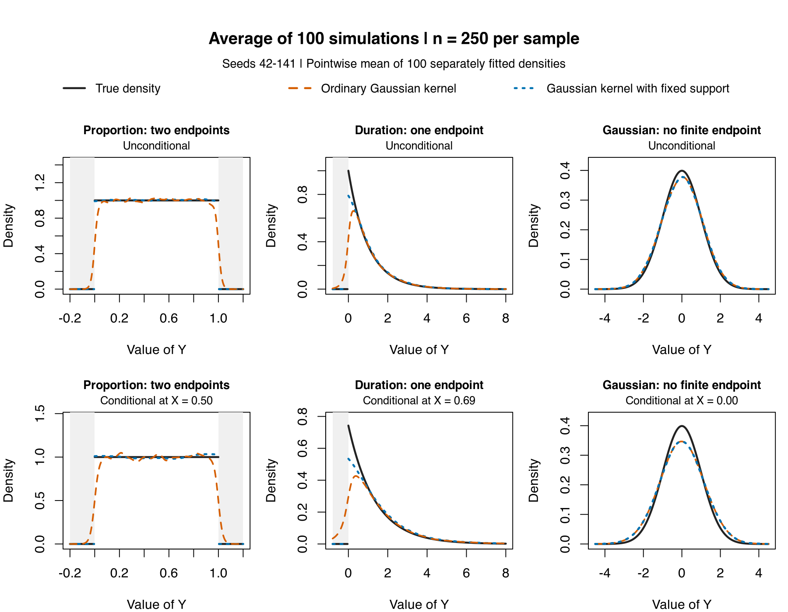

```{r density-distribution-setup}
#| include: false
source("site_helpers.R", local = knitr::knit_global())
```

The `np` package is useful not only for regression but also for unconditional and conditional density estimation, distribution estimation, and nonparametric quantile regression. This page collects those workflows in one place.

If you want a minimal downloadable script for the simplest density workflow, start with [np_density_quickstart.R](www/np_npRmpi/np_density_quickstart.R).

If you want the shortest route to conditional density or quantile workflows, start with:

- [np_distribution_quickstart.R](www/np_npRmpi/np_distribution_quickstart.R)
- [np_conditional_density_quickstart.R](www/np_npRmpi/np_conditional_density_quickstart.R)
- [np_conditional_distribution_quickstart.R](www/np_npRmpi/np_conditional_distribution_quickstart.R)
- [np_quantile_quickstart.R](www/np_npRmpi/np_quantile_quickstart.R)
- [np_lsqreg_quickstart.R](www/np_npRmpi/np_lsqreg_quickstart.R)

## How the four targets connect {#how-the-four-targets-connect}

At the population level, the conditional density, distribution, quantiles,
and mean are connected:

$$
F(y\mid x)=\int_{-\infty}^{y} f(u\mid x)\,du,
\qquad
q_\tau(x)=\inf\{y:F(y\mid x)\geq\tau\},
$$

and

$$
E[Y\mid X=x]=\int y f(y\mid x)\,dy.
$$

When the conditional distribution is continuous at the requested quantile,
$F(q_\tau(x)\mid x)=\tau$. The generalized-inverse definition remains valid
when a distribution has jumps or flat regions.

These identities connect population targets; they do not say to derive one
fitted object mechanically from another. `npreg()`, `npcdens()`, and
`npcdist()` select smoothing for the conditional mean, density, and
distribution targets respectively. Numerically integrating a fitted
conditional-density surface therefore need not reproduce a separately
optimized conditional-distribution estimate. `npqreg()` first selects
bandwidths for the conditional-distribution target, estimates that
distribution, and then inverts it at the requested $\tau\in(0,1)$ values.

## Requesting uncertainty deliberately

The fitted density, distribution, conditional, quantile, mode, and copula
estimators default to `se = FALSE`, so ordinary point estimation does not pay
for uncertainty that may never be used. Request `se = TRUE` when the fitted
object must retain supported asymptotic standard errors, use
`predict(..., se.fit = TRUE)` for prediction errors, and use
`gradients(object, se = TRUE)` only after fitting with the required gradient
and uncertainty state.

The public extractors read stored results; they do not launch a hidden refit.
If uncertainty was omitted, reuse the fitted object's `$bws` component with
`se = TRUE` to add it without repeating bandwidth selection. Explicit
asymptotic plots request the uncertainty they need.

## Unconditional density and distribution: `npudens` and `npudist`

Use these when the object of interest is the joint or marginal distribution itself rather than a regression function.

The Old Faithful data remain a simple and informative illustration because the shape is not well summarized by a simple parametric family.

```r
## Fit unconditional density and distribution objects for the same data
library(np)
data(faithful, package = "datasets")

f_faithful <- npudens(~ eruptions + waiting, data = faithful)
F_faithful <- npudist(~ eruptions + waiting, data = faithful)

summary(f_faithful)
summary(F_faithful)
```

If you want to visualize the estimated surface, you can then plot the objects.

```r
## Plot the fitted unconditional objects to inspect their shape
plot(f_faithful, view = "fixed", main = "")
plot(F_faithful, view = "fixed", main = "")
```

This is a good example of why nonparametric methods can matter: a bimodal or otherwise irregular structure is much easier to reveal when you do not force a simple parametric family on the data.

### Distribution bandwidth-selection support

For `npudistbw()`, the default `do.full.integral = FALSE` evaluates the CDF
criterion on a fast row-aligned marginal-quantile path controlled by `ngrid`.
In a multivariate problem this is not a Cartesian product grid. Set
`do.full.integral = TRUE` when you specifically want the empirical joint
support and can accept the additional cost, or supply `gdat` for a chosen
evaluation cloud or grid.

The `bwmethod = "normal-reference"` route is a fast Silverman-style
rule-of-thumb for exploratory work. It is not a production substitute for
cross-validation or likelihood-based bandwidth selection, and categorical
coordinates receive zero smoothing under that rule.

## Conditional density and distribution: `npcdens` and `npcdist`

Use these when the full conditional distribution matters, not just the conditional mean.

The GDP panel example remains helpful because the conditional distribution changes shape over time.

```r
## Fit conditional density and distribution objects given the covariate
library(np)
data(Italy, package = "np")

fhat <- npcdens(gdp ~ year, data = Italy)
Fhat <- npcdist(gdp ~ year, data = Italy)

summary(fhat)
summary(Fhat)
```

Plots can then be used to inspect the evolving conditional density and conditional distribution.

```r
## Plot the evolving conditional density and distribution surfaces
plot(fhat, view = "fixed", main = "")
plot(Fhat, view = "fixed", main = "")
```

This route is especially useful when the question is not simply whether the mean changes, but whether the entire distribution changes.

### Numerical and uncertainty updates in 0.80-1

Conditional density and distribution level plots can now construct bootstrap
intervals when the continuous response and predictor sides use different
kernel families or orders, including beta kernels on either side. Beta-density
bandwidth selection also supports mixed continuous, unordered, and ordered
data for CVML and bounded target-quadrature CVLS with fixed, generalized
nearest-neighbour, or adaptive nearest-neighbour bandwidths and beta orders 2,
4, 6, and 8.

For positive-degree local-polynomial fits, categorical gradients and effects
report fitted-value endpoint contrasts rather than zero placeholders.
Local-linear and positive-degree local-polynomial conditional density,
distribution, and quantile fits also provide requested paired
categorical-contrast standard errors where the required influence is smooth
and finite; unsupported cases remain explicit `NA` values.

Requested adaptive-nearest-neighbour uncertainty for unconditional density and
distribution fits accounts for donor-specific radii on qualified regular
interior ranks. Fixed-bandwidth copula-density uncertainty includes the joint
covariance with its marginal density estimates. Unqualified boundary or
degenerate cases retain their point estimates and report unavailable standard
errors rather than silently applying a different formula.

Ordered distribution estimates use the corrected Wang--van Ryzin cumulative
upper tail. Readers reproducing results from an earlier release should expect
affected ordered-CDF estimates and cross-validation values to change.

Scaled bandwidth objects now supply their retained physical bandwidths
consistently to fitted, operator, uncertainty, and copula routes. Corrected
deleted-sample geometry for affected beta and bounded-kernel nearest-neighbour
criteria can likewise change selected bandwidths. Those correctness fixes are
confined to the affected routes, and some of the corrected searches require
more work than the former criteria.

## Choosing support bounds {#choosing-support-bounds}

Before estimating a density, consider which values the variable can take. A
proportion has two finite endpoints; a positive duration has a lower endpoint
but need not have a finite upper endpoint. Supply endpoints known from the
application, in the same units as the data.

| What is known about the support? | Unconditional density arguments | Practical interpretation |
|---|---|---|
| Both endpoints, such as a proportion in $[0,1]$ | `ckerbound = "fixed", ckerlb = 0, ckerub = 1` | Use both known endpoints. |
| A lower endpoint only, such as a duration in $[0,\infty)$ | `ckerbound = "fixed", ckerlb = 0, ckerub = Inf` | The largest observed duration is not an upper bound. |
| An upper endpoint only, say $b$ | `ckerbound = "fixed", ckerlb = -Inf, ckerub = b` | Leave the unknown or infinite lower endpoint unrestricted. |
| Finite endpoints exist but are unknown | `ckerbound = "range"` | Use the sample minimum and maximum as proxies; examine sensitivity to the support choice. |
| No finite endpoints, such as a Gaussian variable | Omit the boundary arguments | A finite sample range does not establish bounded support. |

For conditional density estimation, use `cxkerbound`, `cxkerlb`, and `cxkerub`
for the predictors, and `cykerbound`, `cykerlb`, and `cykerub` for the responses.
Make the support decision separately for each side. For example, a duration
response with an unrestricted predictor calls for the `cyker*` arguments only.
`"range"` is a modeling choice about finite support, not an automatic way to
decide whether a boundary exists. Prefer known endpoints when they are available.

### Two endpoints, one endpoint, and an unbounded control

These examples retain the default second-order **Gaussian kernel**. The change
is the support information supplied to the estimator. The top row shows
unconditional densities; the bottom row shows conditional densities at the
population median of $X$. Each comparison uses the same sample of 250 observations,
seed 42, and separately selected likelihood cross-validation (`"cv.ml"`)
bandwidths with five multistarts.

{#fig-density-support fig-alt="One sample, n equals 250, seed 42. Six panels compare the true density and two fitted estimates using ordinary Gaussian kernels and Gaussian kernels with fixed support."}

The unconditional examples are uniform on $[0,1]$, exponential with mean one,
and standard normal. The conditional examples use the corresponding $X$
distributions and
$f(y\mid x)=1+0.8(2x-1)(2y-1)$ on $[0,1]$,
an exponential response with mean $1+0.5x$, and $Y=X+\varepsilon$ with
$\varepsilon\sim N(0,1)$ independent of $X$, respectively. The conditional
proportion density is uniform at the displayed median of $X$ but changes shape
elsewhere; the [three-slice figure](www/np_npRmpi/boundary_awareness/conditional_seed42_n250.png)
shows that variation.

Near a genuine endpoint, an ordinary symmetric kernel assigns mass outside the
support. The bounded Gaussian kernel adjusts for the kernel mass remaining
inside it. This reduces the leading endpoint distortion, although smoothing
bias remains. The uniform example is particularly favorable: with a large
bandwidth, the bounded estimate approaches the uniform density. It is an
illustration of the mechanism, not a promise of equally large gains for every
bounded density.

The fixed-support curves are extended by zero outside their declared support
for display and scoring. The package is evaluated inside that support; its
in-support estimates are unchanged. Support correction is distinct from the
`proper = TRUE` option: these examples use the default local-constant conditional
estimator with `proper = FALSE`, without post-estimation normalization.

Open the [one-sample PNG](www/np_npRmpi/boundary_awareness/seed42_n250.png)
or download [np_density_bounds_quickstart.R](www/np_npRmpi/np_density_bounds_quickstart.R).
It generates all six fits and the figure, and checks the infinite-bounds control.

::: {.callout-note collapse="true" title="Show the runnable R example"}
```{r density-bounds-quickstart-source}
#| echo: false
#| results: asis
emit_source("www/np_npRmpi/np_density_bounds_quickstart.R")
```
:::

### What changes over repeated samples?

The next figure averages the fitted densities from **100 separately simulated
samples of 250 observations each**, using seeds 42--141. Each sample has its
own selected bandwidths. The panels, evaluation points, and axis limits match
the one-sample figure above; no samples are pooled into a larger fit.

{#fig-density-support-average fig-alt="Average of 100 simulations with 250 observations per sample. Matching six-panel layout shows average density estimates against truth, revealing persistent boundary bias in the uncorrected estimates."}

Open the separate [100-simulation-average PNG](www/np_npRmpi/boundary_awareness/mean100_n250.png)
or download its [curve values](www/np_npRmpi/boundary_awareness/mean100_curves_n250.csv).
The average curves show systematic bias and average away much of the
sample-to-sample fluctuation. They do not display estimator variance; the MISE
results below average each sample's integrated squared error and include both.

Across 100 paired draws at each sample size, the known-support specification
reduced mean integrated squared error in both finite-boundary examples.
The table reports the percentage reduction relative to the ordinary estimator.
The seeds were fixed in advance (42--141); both procedures used the same data
and the same optimizer seed within each pair.

| Target | Sample size | Proportion: two endpoints | Duration: one endpoint | Gaussian: no finite endpoint |
|---|---:|---:|---:|---|
| Unconditional | 100 | 86.7% | 74.5% | Numerical tie |
| Unconditional | 250 | 91.6% | 81.0% | Numerical tie |
| Conditional | 100 | 54.5% | 66.3% | Numerical tie |
| Conditional | 250 | 66.3% | 65.2% | Numerical tie |

Unconditional loss integrates squared error over the whole real line.
Conditional loss is $E_X[\int\{\widehat f(y\mid X)-f(y\mid X)\}^2\,dy]$,
using the population distribution of $X$. Thus these are integrated losses,
not equally weighted errors on the plotting grid. Average gains remain positive
in every finite-boundary case when loss is restricted to the true support.
The corrected estimator wins in 98--100 of the 100 pairs in these cases;
improvement on each sample is not guaranteed.

Also available are the [conditional averages at three X values](www/np_npRmpi/boundary_awareness/conditional_mean100_n250.png)
and [conditional surfaces](www/np_npRmpi/boundary_awareness/conditional_surfaces_seed42_n250.png).

Download the [complete MISE summary and paired Monte Carlo standard errors](www/np_npRmpi/boundary_awareness/summary.csv),
[per-fit results](www/np_npRmpi/boundary_awareness/per_fit.csv), and
[simulation definitions and numerical checks](www/np_npRmpi/boundary_awareness/README.md).

::: {.callout-note collapse="true" title="Infinite bounds and the conditional estimator"}
At a common bandwidth, `"fixed"` with `(-Inf, Inf)` reproduced ordinary
predictions exactly in all 400 Gaussian pairs. Separately selected CVML fits
were identical unconditionally and differed by at most $6.30\times10^{-8}$
conditionally. For an unbounded variable, simply omit the boundary arguments.

This does not establish equality of every bandwidth selector. In `np` 0.80-1,
conditional `"cv.ls"` with explicitly infinite response bounds uses a finite
quadrature surrogate and issues a warning; it can select different bandwidths
from the ordinary unbounded route. See the [selector checks](www/np_npRmpi/boundary_awareness/infinite_bounds_selectors.csv).

For these fixed-bandwidth local-constant conditional fits, the common
query-centered correction on the $X$ side cancels from the density ratio at
a given bandwidth. The direct correction shown here is on the $Y$ side.
Supplying the correct $X$ support remains appropriate, but these examples do
not demonstrate a separate $X$-boundary shape improvement.
:::

## Practitioner-oriented extras

Some applied tasks are a little different from the standard "fit and inspect"
workflow. The Cambridge practitioner material suggests three especially useful
ones:

- estimate a smooth probability function on discrete support,
- draw a smooth resample from a fitted unconditional density,
- draw a smooth resample from a fitted conditional density.

The first of these is compact enough to show inline.

Source file: [np_probability_quickstart.R](www/np_npRmpi/np_probability_quickstart.R)

```{r probability-quickstart-source}
#| echo: false
#| results: asis
emit_source("www/np_npRmpi/np_probability_quickstart.R")
```

Additional practitioner scripts:

- [np_density_resample_quickstart.R](www/np_npRmpi/np_density_resample_quickstart.R)
- [np_conditional_density_resample_quickstart.R](www/np_npRmpi/np_conditional_density_resample_quickstart.R)

## Copulas: `npcopula`

If the main object of interest is the dependence structure itself rather than a
regression function, `npcopula` is the natural route.

The formula interface is now the streamlined first stop: when `bws` is not
supplied, `npcopula()` automatically builds the required `npudistbw()`
bandwidth object for the default copula target, or `npudensbw()` when
`target = "density"`. For the default two-dimensional grid workflow, omitting
`u` also triggers automatic construction of a probability grid.

Source file: [np_copula_quickstart.R](www/np_npRmpi/np_copula_quickstart.R)

```{r copula-quickstart-source}
#| echo: false
#| results: asis
emit_source("www/np_npRmpi/np_copula_quickstart.R")
```

The fitted object retains its public bandwidth state in `copula_fit$bws`.
Copula prediction is expressed in marginal probability coordinates, not in raw
data on the original variable scale:

```r
## Evaluate the fitted copula on a small Cartesian probability grid
u_eval <- list(u1 = c(0.25, 0.50, 0.75),
  u2 = c(0.25, 0.50, 0.75))
predict(copula_fit, u = u_eval)
```

The compatibility `newdata` route also expects columns named `u1`, `u2`, and so
on; it does not transform raw `x` and `y` values into probability coordinates.
For higher-dimensional copulas, provide `u` explicitly or use
`evaluation = "sample"` rather than asking for an exponentially growing
automatic grid.

Set `neval` when constructing `npcopula()` if you want a different automatic
grid size. It is not a post-fit plotting control: `plot.npcopula()` rejects
`neval`, while a custom fitted grid can be supplied through `u` at construction.

For LP-capable conditional families, the same modern shortcut is now available:

```r
## nomad = "auto" uses exhaustive search for p = 1 and NOMAD otherwise.
fhat_lp <- npcdens(eruptions ~ waiting, data = dat, nomad = "auto", nmulti = 1)
Fhat_lp <- npcdist(eruptions ~ waiting, data = dat, nomad = "auto", nmulti = 1)
```

That is the convenience route for automatic local-polynomial degree and
bandwidth search in a single call. As with regression, it requires the `crs`
package because NOMAD degree search is provided there.

When the local-polynomial degree is above zero, `proper = TRUE` is also
available in the `npc*` calls and related plot routes. This enforces proper
conditional density/distribution output in the practical sense used here:
non-negative and integrating to one conditional on `x`.

The same local-polynomial extensions now also broaden derivative support across
the conditional family. In practice, that means conditional density,
conditional distribution, conditional quantile, and related fitted objects can
now expose richer gradient and higher-order derivative routes whenever the
selected polynomial degree is high enough to support them.

## Nonparametric quantile regression: `npqreg`

Use `npqreg` when your interest lies in conditional quantiles rather than means.

The direct formula interface is now the natural first stop. When `bws` is not
supplied, `npqreg()` automatically calls `npcdistbw()` internally to select
bandwidths for the conditional-distribution target. It then estimates that
distribution and inverts it at the requested $\tau\in(0,1)$ values.
Bandwidth-selection options supplied to `npqreg()` are passed through to the
internal `npcdistbw()` call, so you can still control the underlying
conditional-distribution fit without breaking the high-level workflow.

```r
## Extract several quantiles from one selected conditional-distribution fit
library(np)
data(Italy, package = "np")

qfit <- npqreg(gdp ~ ordered(year),
               data = Italy,
               tau = c(0.25, 0.50, 0.75))
```

Then compare the fitted quantiles:

```r
## Overlay the fitted conditional quantiles
plot(qfit)
```

If you later want to reuse the selected bandwidths for additional quantiles
without recomputing cross-validation, you still can. Call `npqreg()` when you
need the fitted values as an object, or pass `tau` directly to `plot()` when
graphical inspection is all you need:

```r
qmed <- npqreg(gdp ~ ordered(year), data = Italy, tau = 0.50)
qfit <- npqreg(bws = qmed$bws, tau = c(0.25, 0.50, 0.75))
plot(qfit)

## Or, if plotting is the only goal:
plot(qmed, tau = c(0.25, 0.50, 0.75))
```

If you want derivative information, request it in the fit:

```r
qgrad <- npqreg(gdp ~ ordered(year),
                data = Italy,
                tau = 0.50,
                gradients = TRUE)

plot(qgrad, gradients = TRUE)
```

The same formula interface can also use the automatic local-polynomial
degree-and-bandwidth search when the conditioning data include at least one
continuous variable:

```r
Italy$year_numeric <- as.numeric(as.character(Italy$year))

qfit_lp <- npqreg(gdp ~ year_numeric,
                  data = Italy,
                  tau = c(0.25, 0.50, 0.75),
                  ## nomad = "auto" uses exhaustive search for p = 1 and NOMAD otherwise.
                  nomad = "auto")
```

This is a good example of the intended progression: start with the direct
high-level route, then reuse the retained bandwidth object only when you
specifically want to avoid recomputing it.

Conditional quantile inversion requires a monotone dependent-variable CDF.
Accordingly, `npqreg` supports `cykerorder = 2` for this route and rejects
higher-order dependent-variable CDF kernels, which can be nonmonotone.

## Location-scale quantile regression: `nplsqreg`

Use `nplsqreg` when you want a location-scale conditional quantile route rather
than direct inversion of a fitted conditional distribution.

The user-facing workflow is meant to feel just as natural as `npqreg`. When
`bws` is omitted, `nplsqreg()` calls `nplsqregbw()` internally to select the
underlying bandwidths and location-scale shift state. You still retain the
selected bandwidth object for exact reuse, but the normal first stop is the
high-level formula interface.

Source file: [np_lsqreg_quickstart.R](www/np_npRmpi/np_lsqreg_quickstart.R)

```{r lsqreg-quickstart-source}
#| echo: false
#| results: asis
emit_source("www/np_npRmpi/np_lsqreg_quickstart.R")
```

For a vector-`tau` fit, `predict(qfit, tau = ...)` can select one or more
stored quantiles without repeating bandwidth selection or location-scale
calibration. Several values are returned in the requested order, with standard
errors and training scores kept aligned when `se.fit = TRUE`. A value that was
not fitted is rejected explicitly; fit that quantile first rather than asking
prediction to create new model state.

If you later want to reuse the selected state for a specific quantile without
rerunning the full search, the retained `bws` object supports that directly:

```r
## Reuse an exact location-scale bandwidth object for one fitted tau
qmed <- nplsqreg(gdp ~ ordered(year), data = Italy, tau = 0.50)
qfit <- nplsqreg(bws = qmed$bws, tau = 0.50)
plot(qfit)
```

As with the other LP-capable conditional families, `nomad = "auto"` can also be
used on supported continuous-data routes when you want automatic
degree-and-bandwidth search in the same high-level call. For `nplsqreg`, a
one-dimensional smoothing problem evaluates the complete requested degree
lattice and jointly optimizes the bandwidth and `delta` at each degree;
higher-dimensional problems use the NOMAD/Powell policy.

For vector `tau`, the location-scale fits are estimated independently. Their
asymptotic standard errors are conditional on the selected bandwidths, pilot
scale, and shift state, and the fitted quantile curves are not monotonized, so
finite-sample crossing is possible.

## When should I use these instead of regression?

| If you want... | Start with |
|---|---|
| A regression function or conditional mean | `npreg` |
| An unconditional density or distribution | `npudens`, `npudist` |
| A conditional density or conditional distribution | `npcdens`, `npcdist` |
| Conditional quantiles | `npqreg` |
| Location-scale conditional quantiles | `nplsqreg` |

## Practical advice

- density and conditional-density workflows can be computationally heavier than users expect,
- use explicit bandwidth objects when reusing the same structure across multiple fits,
- plots are often the most informative part of the workflow,
- if the run becomes expensive and the workflow is stable, that may be a reason to move to `npRmpi`.

## What to read next

- [Kernel Primer](kernel_primer.qmd)
- [Entropy and Testing](entropy_tests.qmd)
- [Semiparametric Models](semiparametric_models.qmd)
- [MPI and Large Data](mpi_large_data.qmd)
