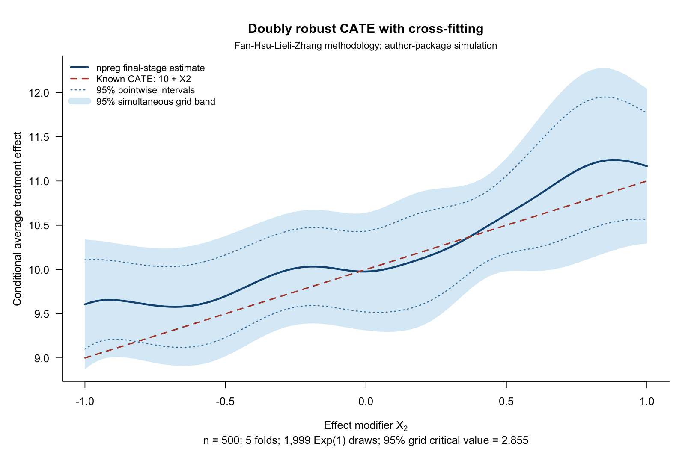

This example combines high-dimensional nuisance estimation with a
low-dimensional kernel regression to estimate how a treatment effect varies
with a selected covariate. It follows
[Fan, Hsu, Lieli and Zhang (2022)](https://doi.org/10.1080/07350015.2020.1811102).
`hdm` supplies the lasso nuisance fits, `npreg` supplies the final local-linear
smoother, and the script implements the paper's variance and multiplier
inference calculations explicitly.

[Download the complete R script](www/np_npRmpi/doubly_robust_cate/np_crossfit_cate.R).
It requires `np` and `hdm`, simulates its own data, prints a numerical summary,
and displays the figure in your R or RStudio graphics window. It creates no
folders or output files and does not install packages. The example was checked
with `np` 0.80-1 and `hdm` 0.3.2.

For regression discontinuity and a randomized-trial example, start with
[Causal Inference with Local Polynomials](causal_inference.qmd).

## The target and its assumptions

Let $D$ indicate treatment, $Y$ be the observed outcome, $X$ contain the
pre-treatment adjustment covariates, and $Z$ be a selected component of $X$.
The target is the reduced-dimensional conditional average treatment effect,

$$
\tau(z)=E[Y(1)-Y(0)\mid Z=z].
$$

Identification requires consistency, unconfoundedness conditional on $X$,
and overlap between treatment groups. Conditioning the reported effect on
one variable does not mean adjusting for only that variable: the nuisance
models use the full adjustment set. Cross-fitting does not resolve
unmeasured confounding or a lack of overlap.

## Doubly robust scores and cross-fitting

Write $e(x)=P(D=1\mid X=x)$ and $\mu_d(x)=E[Y\mid D=d,X=x]$.
The score combines outcome predictions with inverse-probability-weighted
residuals:

$$
\begin{aligned}
\widehat\psi_i={}&\widehat\mu_1(X_i)-\widehat\mu_0(X_i)\\
&+\frac{D_i\{Y_i-\widehat\mu_1(X_i)\}}{\widehat e(X_i)}\\
&-\frac{(1-D_i)\{Y_i-\widehat\mu_0(X_i)\}}{1-\widehat e(X_i)}.
\end{aligned}
$$

Its population conditional mean recovers the CATE if the propensity model
is correct or both outcome regressions are correct, subject to the usual
integrability and overlap conditions. Valid confidence bands require the
paper's additional nuisance-rate and smoothing conditions; double robustness
alone is not a coverage guarantee.

The script uses five balanced random folds. For each fold it:

1. Fits the propensity and treatment-specific outcome models on the other
   four folds, using `hdm::rlassologit` and `hdm::rlasso`.
2. Predicts those nuisance functions and constructs scores for the held-out
   observations.
3. Fits a Gaussian local-linear `npreg` regression of the held-out scores on
   $Z$, evaluated on a common grid.

It then averages the five fitted curves. This follows the paper's
separate-fold construction; pooling all cross-fitted scores into a single
regression generally gives a different finite-sample estimate.

The essential smoothing step is:

```r
# held indexes one fold; score contains its held-out doubly robust scores.
fit <- npreg(txdat = dat$X2[held], tydat = score[held],
             exdat = at, bws = h, regtype = "ll",
             ckertype = "gaussian", ckerorder = 2,
             bwtype = "fixed", bwscaling = FALSE, se = FALSE)
fold_curves[, k] <- fitted(fit)
# After completing all folds:
estimate <- rowMeans(fold_curves)
```

The bandwidth is the paper's full-sample undersmoothing rule,
$h=1.06\,s_Z n^{-2/7}$. Ordinary regression cross-validation optimizes a
different criterion and is not substituted for this inference prescription.

## A seeded example with known truth

The example uses the authors' package simulation: 500 observations, 100
independent standard-normal covariates, and $Z=X_2$. Treatment probability
depends on $X_{97},\ldots,X_{100}$; the treated potential outcome is
$10+X_1+X_2+X_3+X_4+\epsilon$, with independent standard-normal noise.
The untreated potential outcome is zero, giving $\tau(z)=10+z$.
All 100 covariates enter the nuisance formulas.

In this particular generator, the propensity and outcome functions use
disjoint independent covariates. It demonstrates the computation rather
than testing bias removal under confounding. It is also distinct from the
paper's empirical maternal-smoking application.

{#fig-crossfit-cate fig-alt="A blue estimated treatment-effect curve follows the rising true line 10 plus X2. A shaded simultaneous grid band surrounds the estimate and contains the true curve; dotted pointwise intervals are narrower."}

The grid is $-1,-0.98,\ldots,1$, the bandwidth is **0.186776**, and the
1,999 multiplier draws give a two-sided 95% critical value of **2.855**,
compared with **1.960** for the pointwise intervals. The known curve lies
inside the simultaneous band in this sample. This is a reproducible
illustration, not a repeated-sampling coverage study. Seeds for the data,
folds, nuisance fits and multipliers are recorded in the script.

::: {.callout-note}
## Multiplier choice

The example explicitly uses positive **Exp(1)** weights, which have mean
and variance one and satisfy the paper's general multiplier assumption.
The paper's illustrated algorithm uses **N(1,1)** weights. Those weights
produced indefinite local fits in 49 of 1,999 draws in this example; all
exponential draws were retained. The exponential option already exists in
`hdcate`'s R6 interface. See the
[reproducibility note](www/np_npRmpi/doubly_robust_cate/README.md)
for the numerical diagnosis and reference-software repairs.
:::

## Uniform inference

The script computes each fold's variance using the paper's kernel-weighted
score-residual formula. It averages the fold variances before taking the
square root and scaling by $\sqrt{nh}$ to obtain the standard error.

For every multiplier draw, it keeps the nuisance fits and bandwidth fixed,
assigns independent observation-level weights, and refits the second-stage
local-linear regressions. The same weights are used across the evaluation
grid, preserving dependence between the fitted values. Both the local
design matrix and the score moments change with those weights.

The 95% empirical quantile of the maximum absolute standardized deviation
supplies the simultaneous critical value. This approximates the paper's
uniform inference using a maximum on the **101 specified grid points**;
joining endpoints for display does not establish coverage between them.
The calculation differs from the fixed-covariance Gaussian simulation in
the [cholesterol example](causal_inference.qmd#randomized-treatment-effects-with-simultaneous-bands).

`npreg` provides the original fold fits. The script adds the paper-specific
variance and weighted local-linear refits explicitly; ordinary `se()` or
plotting intervals are not substituted for those calculations. These bands
describe uncertainty in the conditional average treatment effect, not
prediction uncertainty for an individual's outcome.

## Reproduce and inspect the checks

After downloading the script, run:

```r
source("np_crossfit_cate.R")
# Inspect the fitted curve and intervals in memory:
head(cate_results$curve)
```

The `cate_results` object also contains the summary, data, folds, seeds, scores,
propensities and multiplier draws.

The held-out fitted propensities range from **0.0139 to 0.9751** in this
sample. The script reports them and does not clip or trim them. For a new
application, inspect overlap and choose the adjustment set before treating
the resulting curve as causal.

The standalone script was checked against an isolated repair of the
authors' `hdcate` package, pinned to a specific source revision. At matching
folds, nuisance predictions and bandwidth, the largest fold-fit difference
was $2.14\times10^{-14}$; simultaneous-band endpoints agreed within
$1.25\times10^{-14}$. These are numerical-equivalence checks, not a comparison
with untouched package defaults or proof of finite-sample coverage.

Download the [fitted curve and intervals](www/np_npRmpi/doubly_robust_cate/cate_curve.csv),
[reference comparison](www/np_npRmpi/doubly_robust_cate/comparison_summary.csv),
[standalone checks](www/np_npRmpi/doubly_robust_cate/standalone_parity.csv),
or the [reference-verification bundle](www/np_npRmpi/doubly_robust_cate/reference_verification.zip).
The [reproducibility note](www/np_npRmpi/doubly_robust_cate/README.md)
records the repairs, multiplier choice, versions and verification commands.

::: {.callout-note collapse="true"}
## Complete example code

```{r crossfit-cate-source}
#| echo: false
#| results: asis
cat("```r\n", paste(readLines("www/np_npRmpi/doubly_robust_cate/np_crossfit_cate.R"), collapse = "\n"), "\n```\n", sep = "")
```
:::

## Reference and scope

The reference is Fan, Q., Hsu, Y.-C., Lieli, R. P. and Zhang, Y. (2022),
“Estimation of Conditional Average Treatment Effects with High-Dimensional
Data,” *Journal of Business & Economic Statistics*, 40(1), 313–327.
See the [published paper](https://doi.org/10.1080/07350015.2020.1811102)
and [open preprint](https://arxiv.org/abs/1908.02399v5).
