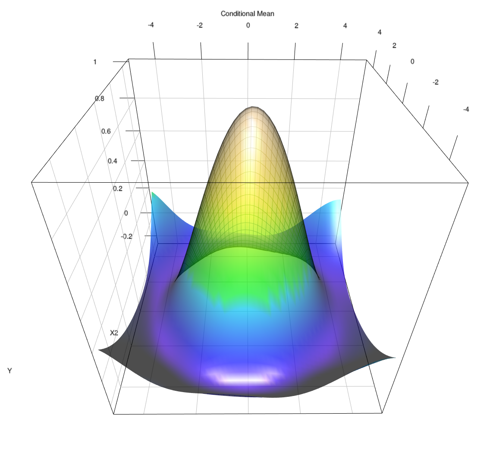

# Gallery of code for `np`, `npRmpi`, and `crs`

This site is meant to help you get to working code quickly. The sidebar is now organized by task rather than by old document names, and the search box should find function names such as `npreg`, `npudens`, `crs`, and `npRmpi.init`.

::: {.grid}
::: {.g-col-12 .g-col-lg-7}
This gallery complements the package help pages, examples, and vignettes. The aim is simple: make it easy to see what each package is for, copy a small working example, and then move on to longer scripts only if you need them.

If you are new to these packages, start with [Choose a Package](primer.qmd). If you want runnable code immediately, go to [Quickstarts](quickstarts.qmd). If you already know the method you want, go directly to [Kernel Methods](np_npRmpi.qmd), [MPI and Large Data](mpi_large_data.qmd), [Splines](crs.qmd), or [Worked Examples](regression.qmd).
:::

::: {.g-col-12 .g-col-lg-5}
{.hero-image}
:::
:::

::: {.quick-note}
This website is linked from my academic site and is intended as a practical working companion, not as a substitute for the package manuals or the underlying papers.
:::

::: {.callout-tip}
**New to `np`?** Watch [Your first `np` result](video_demos.qmd#first-np-result),
a 24-second RStudio walkthrough, then continue with the copyable script.
:::

::: {.callout-note}
## Current package status

`crs` `0.15-46` (published August 19, 2026), `npRmpi` `0.80-1`, and `np`
`0.80-1` are available on CRAN. The `np` and `npRmpi` releases are dated
September 11, 2026.

The examples use current public controls such as `B`, `se`, `se.fit`,
`gradient.order`, `errors`, `bootstrap`, `band`, `data.rug`, and
`data.overlay`. The [0.80-1 migration checklist](faq.qmd#what-should-i-check-when-moving-to-080-1)
summarizes the argument changes most likely to affect older code.
:::

## Current Capabilities

- [0.80-1 update and migration notes](runtime_and_scaling.qmd): `np` and `npRmpi` `0.80-1` standardize bootstrap, uncertainty, and dotted plotting controls, correct heterogeneous local-polynomial bases and categorical effects, modernize instrumental-regression workflows, and strengthen numerical, memory, progress, and serial/MPI behavior across the estimator families.
- [Spline updates](crs.qmd): `crs` `0.15-46` retains the common named plotting controls and `crshat()` operator workflow, adds formula/data and S3 support for instrumental spline regression, and provides the observed NOMAD interface used for responsive progress in downstream degree searches.
- [Local polynomial workflows](np_npRmpi.qmd): `np` and `npRmpi` support local polynomial capability across the conditional family, with joint selection of polynomial degrees and bandwidths for mixed data, gradient support throughout the conditional estimators, and derivative estimation of arbitrarily high order, limited only by the selected polynomial degree whether set manually or chosen automatically for the underlying smoothness class.
- [Bounded-support and proper conditional density/distribution methods](density_distribution_quantiles.qmd): conditional density and distribution workflows include bounded-kernel routes for known bounds and practical unknown-bound settings, plus `proper = TRUE` for proper local-polynomial conditional density/distribution estimates when degree exceeds zero.
- [Location-scale quantile regression](density_distribution_quantiles.qmd): `nplsqreg` and `nplsqregbw` provide a first-class location-scale quantile workflow with formula and bandwidth-object routes, scalar or vector `tau`, prediction, residuals, summaries, plots, and the same NOMAD-enabled local-polynomial degree-and-bandwidth search style where supported.
- [Conditional quantile regression](density_distribution_quantiles.qmd): `npqreg` provides a direct formula interface, automatic `npcdistbw()` bandwidth selection when `bws` is omitted, vector `tau` support, `plot(..., tau = ...)` reuse of existing bandwidths, conditional-quantile gradients and standard errors, and `nomad = "auto"` pass-through for local-polynomial degree-and-bandwidth search.
- [Conditional mode classification](classification_modes.qmd): `npconmode` is a first-class high-level estimator, with direct formula/data/newdata workflows, automatic `npcdensbw()` bandwidth selection when `bws` is omitted, conditional-density search controls including `nomad = "auto"`, mirrored degree/search metadata in returned objects and summaries, properized fitted class probabilities for non-local-constant routes before selecting the modal outcome, and level-specific class-probability effects.
- [Copula estimation](density_distribution_quantiles.qmd): `npcopula` is a first-class high-level estimator with a direct formula interface, automatic `npudistbw()` or `npudensbw()` selection when `bws` is omitted, automatic two-dimensional probability-grid construction for the default grid route, and easy reuse of the selected bandwidth object when you want a custom `u` grid or copula-density target.
- [Hat-matrix and operator helpers](semiparametric_models.qmd): `npreghat`, `npindexhat`, `npplreghat`, and `npscoefhat` provide one-call operator routes that simplify constrained nonparametric and semiparametric estimation by replacing much of the manual hat-matrix construction and solve-based setup, while `npudenshat`, `npudisthat`, `npcdenshat`, and `npcdisthat` extend the same streamlined operator style to the density/distribution family.
- [Variability bounds on plots](regression.qmd): pointwise, Bonferroni, and simultaneous bounds share the plotting surface, and `band = "all"` presents all three together.
- [Interactive plotting surfaces](plotting_and_intervals.qmd): `renderer = "rgl"` supports interactive 3D rotation/zoom when `rgl` is installed, while `data.rug` and `data.overlay` control rugs and observed-data overlays on supported routes.
- [MPI operational routes](mpi_large_data.qmd): `npRmpi` session and attach routes let users work directly with `np`-style code, while the profile route remains available when needed.

::: {.grid}
::: {.g-col-12 .g-col-md-6}
::: {.home-card}
### [Choose a Package](primer.qmd)

Start here if you are deciding between `np`, `npRmpi`, and `crs`, or if you want a quick route to the right tool.
:::
:::

::: {.g-col-12 .g-col-md-6}
::: {.home-card}
### [Install and Get Started](R_RStudio.qmd)

Short install notes, a minimal first run, and pointers for what to do next once the packages are installed.
:::
:::

::: {.g-col-12 .g-col-md-6}
::: {.home-card}
### [Quickstarts](quickstarts.qmd)

Small runnable scripts for `np`, `npRmpi`, and `crs`, shown inline so you can copy directly from the page.
:::
:::

::: {.g-col-12 .g-col-md-6}
::: {.home-card}
### [Kernel Methods](np_npRmpi.qmd)

Core workflows for `np`, together with a clean route to `npRmpi` when jobs become larger or more time consuming.
:::
:::

::: {.g-col-12 .g-col-md-6}
::: {.home-card}
### [MPI and Large Data](mpi_large_data.qmd)

Updated guidance for `npRmpi`, with `session` mode now treated as the main interactive path rather than an afterthought.
:::
:::

::: {.g-col-12 .g-col-md-6}
::: {.home-card}
### [Worked Examples](regression.qmd)

Copyable code snippets on the page, plus links to longer scripts when you want the full commented version.
:::
:::

::: {.g-col-12 .g-col-md-6}
::: {.home-card}
### [Multivariate Regression](multivariate_regression.qmd)

Mixed-data regression, partial plots, and prediction using `wage1` as a practical first multivariate example.
:::
:::

::: {.g-col-12 .g-col-md-6}
::: {.home-card}
### [FAQ and Troubleshooting](faq.qmd)

Common questions, support routes, and links to the current canonical sources.
:::
:::
:::

## Learn by topic

::: {.grid}
::: {.g-col-12 .g-col-md-6}
::: {.home-card}
### [Kernel Primer](kernel_primer.qmd)

Short conceptual introduction to mixed-data kernels, bandwidth objects, and the basic `np` workflow.
:::
:::

::: {.g-col-12 .g-col-md-6}
::: {.home-card}
### [Density, Distribution, Quantiles](density_distribution_quantiles.qmd)

Route to `npudens`, `npudist`, `npcdens`, `npcdist`, and `npqreg` workflows.
:::
:::

::: {.g-col-12 .g-col-md-6}
::: {.home-card}
### [Semiparametric Models](semiparametric_models.qmd)

Partially linear, single-index, and varying-coefficient workflows in one place.
:::
:::

::: {.g-col-12 .g-col-md-6}
::: {.home-card}
### [Entropy and Testing](entropy_tests.qmd)

Overview of the entropy-based testing procedures and a small “roll your own” example.
:::
:::

::: {.g-col-12 .g-col-md-6}
::: {.home-card}
### [Classification and Modes](classification_modes.qmd)

Nonparametric classification and conditional-mode workflows, including the `birthwt` example.
:::
:::

::: {.g-col-12 .g-col-md-6}
::: {.home-card}
### [Build With npksum](npksum_custom.qmd)

For users who want to construct custom kernel objects or estimators rather than only use the higher-level wrappers.
:::
:::

::: {.g-col-12 .g-col-md-6}
::: {.home-card}
### [Spline Primer](spline_primer.qmd)

Conceptual introduction to regression splines, knots, basis functions, and how that connects to `crs`.
:::
:::

::: {.g-col-12 .g-col-md-6}
::: {.home-card}
### [Code Catalog](code_catalog.qmd)

Broader script library across `np`, `npRmpi`, and `crs`, including older scripts and fuller worked examples beyond the first quickstarts.
:::
:::
:::

## Need help fast?

::: {.grid}
::: {.g-col-12 .g-col-md-6}
::: {.home-card}
### [FAQ and Troubleshooting](faq.qmd)

Short answers to the most common “where do I start?” and “why is this happening?” questions.
:::
:::

::: {.g-col-12 .g-col-md-6}
::: {.home-card}
### [Data Preparation](data_preparation.qmd)

Variable classes, factors, ordered variables, formulas, and the data-typing mistakes that most often trip people up.
:::
:::

::: {.g-col-12 .g-col-md-6}
::: {.home-card}
### [Runtime and Scaling](runtime_and_scaling.qmd)

What to do when cross-validation, bootstrap, spline search, or large jobs become slow or memory-hungry.
:::
:::

::: {.g-col-12 .g-col-md-6}
::: {.home-card}
### [Spline Search and Tuning](spline_search_and_tuning.qmd)

Practical `crs` advice on search size, smoothness, knots, and when to narrow the spline search space.
:::
:::
:::

## Notes

- Search should help if you know the function name but not where it lives.
- [Quickstarts](quickstarts.qmd) is the shortest route to a small runnable script.
- The reference page groups functions by task rather than repeating a long handwritten index.
- Additional resources, including books and papers, are collected on [Books, Papers, and Citation](books_papers.qmd).

Feedback is welcome. My academic page is [experts.mcmaster.ca/display/racinej](https://experts.mcmaster.ca/display/racinej), and additional materials remain available at [jeffreyracine.github.io/research](https://jeffreyracine.github.io/research).
